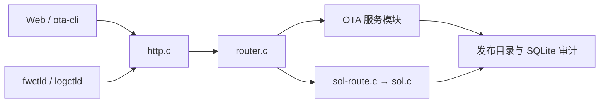

# Device Manager 架构与扩展边界

## 运行组件

| 位置 | 组件 | 职责 |
| --- | --- | --- |
| 主机 | `device-server` | 托管离线 Web、OTA 制品与发布状态、设备事务和 SOL 日志 |
| 主机 | `ota-cli` | 调用服务端接口上传、发布和查询；不直接改服务端数据目录 |
| 设备 | `fwctld` | 等待网络，轮询发布，校验下载，调用 `fwctl`，上报升级结果 |
| 设备及 initramfs | `fwctl` | 验证固件、操作 A/B 分区、恢复、健康确认；不依赖服务端在线 |
| 设备 | `logctld` / `logctl` | 本地日志采集、归档与查询；SOL 仅传送只读日志 |

## 主机代码分层

`ota/server/device-server.c` 只拥有进程生命周期、监听套接字和启动选项。`http.c` 处理有界 HTTP 头、重复字段、请求长度、对端地址和响应格式，不依赖固件目录或 SOL 数据库。`router.c` 按路径协调 OTA 业务接口，`sol-route.c` 独立处理 SOL 请求。`ota-admin.c`、`ota-catalog.c`、`ota-history.c`、`ota-quarantine.c` 等文件负责发布、持久化、审计和异常固件停发；路由层不直接修改这些数据库。`ota/shared/` 定义设备与主机共同使用的 OTA 报告和协议格式。

新增 HTTP 能力时，在对应业务模块实现存储和校验，再接入路由；不要把数据库逻辑放进 `http.c`。新增设备能力时，先定义协议字段及向后读取规则，再分别修改 `ota/shared/`、代理和服务端。`firmware/` 的分区事务保持独立于网络协议，`fwctl` 只通过明确的接口调用它。EDK 管理外设，设备管理组件不复制 EDK 的驱动或业务状态。

## 稳定性约束

固件的 tag 与内容 SHA256 是不同字段；版本保持 `v0.0.1`，除非明确要求升级。普通日志只显示 ID 前 8 位，校验和审计使用完整哈希。服务器同一时间只有一个当前发布版本；异常固件需要停发并保留审计。OTA 成功以设备重启后的健康确认和结果上报为准。Web 在调试模式免凭据，SOL 仍是只读通道；后续增加权限层时应在 HTTP 路由入口统一执行，而非散落在页面脚本中。

验证命令见根目录 `README.md`。涉及固件的变更必须用板级镜像、真实 OTA 和重启后的健康状态验证；主机单元测试不能替代设备启动验证。
