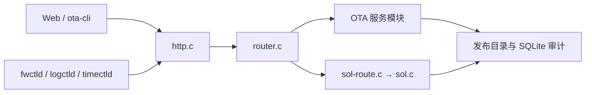
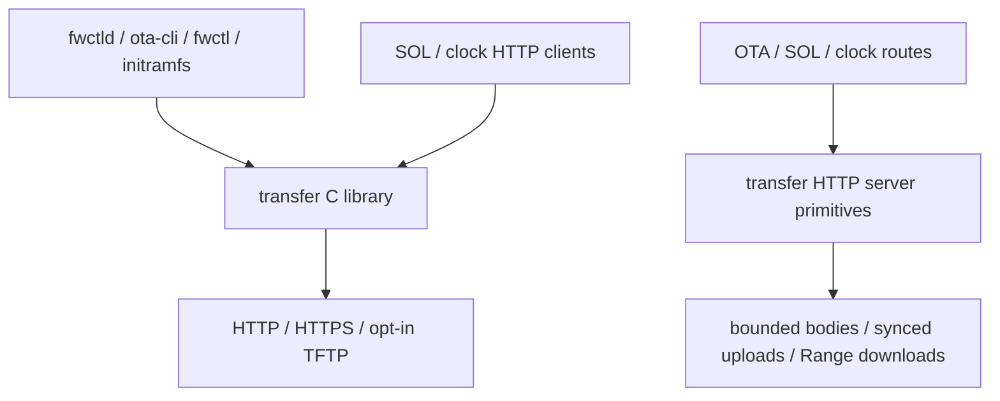

# Device Manager 架构与扩展边界

## 运行组件

| 位置 | 组件 | 职责 |
| --- | --- | --- |
| 主机 | `device-server` | 托管离线 Web、OTA 制品与发布状态、设备事务和 SOL 日志 |
| 主机 | `ota-cli` | 调用服务端接口上传、发布和查询；不直接改服务端数据目录 |
| 设备 | `fwctld` | 等待网络，轮询发布，校验下载，调用 `fwctl`，上报升级结果 |
| 设备及 initramfs | `fwctl` | 验证固件、操作 A/B 分区、恢复、健康确认；不依赖服务端在线 |
| 设备 | `logctld` / `logctl` | 本地日志采集、归档与查询；SOL 仅传送只读日志 |
| 设备 | `timectld` / `timectl` | 独立时间源管理、NTP/HTTP 校准、RTC 和状态回报；不依赖 SOL 生命周期 |

## 主机代码分层

`ota/server/device-server.c` 只拥有进程生命周期、监听套接字和启动选项。`transfer/` 处理有界 HTTP 头、请求长度、对端地址、文件收发与 Range；`http.c` 将公共传输类型适配为业务请求，保留 Origin、HWID、设备上下文等字段校验，不依赖固件目录或 SOL 数据库。`router.c` 按路径协调 OTA 业务接口，`sol-route.c` 独立处理 SOL 请求。`ota-admin.c`、`ota-catalog.c`、`ota-history.c`、`ota-quarantine.c` 等文件负责发布、持久化、审计和异常固件停发；路由层不直接修改这些数据库。`ota/shared/` 定义设备与主机共同使用的 OTA 报告和协议格式。

新增 HTTP 能力时，在对应业务模块实现存储和校验，再接入路由；不要把数据库逻辑放进 `http.c`。新增设备能力时，先定义协议字段及向后读取规则，再分别修改 `ota/shared/`、代理和服务端。`firmware/` 的分区事务保持独立于网络协议，`fwctl` 只通过明确的接口调用它。EDK 管理外设，设备管理组件不复制 EDK 的驱动或业务状态。

## 稳定性约束

固件的 tag 与内容 SHA256 是不同字段；版本保持 `v0.0.1`，除非明确要求升级。普通日志只显示 ID 前 8 位，校验和审计使用完整哈希。服务器同一时间只有一个当前发布版本；异常固件需要停发并保留审计。OTA 成功以设备重启后的健康确认和结果上报为准。Web 在调试模式免凭据，SOL 仍是只读通道；后续增加权限层时应在 HTTP 路由入口统一执行，而非散落在页面脚本中。

验证命令见根目录 `README.md`。涉及固件的变更必须用板级镜像、真实 OTA 和重启后的健康状态验证；主机单元测试不能替代设备启动验证。

## 公共传输层

`fwctld`、`ota-cli`、`fwctl` 的 URL 固件源、initramfs 恢复、SOL 转发与 HTTP 校时统一调用 `transfer/include/dm/transfer.h`。服务端使用 `transfer-server.h`。业务层不直接链接调用 libcurl API，也不启动 curl/sha256sum 子进程。公共库负责传输、取消、限速、超时、长度和 SHA256 验证、断点落盘；业务模块负责目标选择、OTA 事务、归档提交和审计。

公共传输层不维护设备在线状态，不安装分区、不决定升级成功，也不清理启动日志缓存。文件续传使用 SHA256 绑定的持久化检查点；SOL 使用服务器确认游标，完成归档确认后才清理 RAM 缓存。接口、错误分类和一致性边界见 [传输组件](../transfer/README.md)。

闭合启动日志由 `logging/archive.c` 生成有界包与持久收据，`bundle-forward.c` 调度单包续传，
`ota/server/sol-bundle.c` 管理完整性确认和有限归档目录；公共 `transfer` 库提供游标推送、
SHA256、文件收发，不决定保留策略。实时日志、早期双缓冲快照和闭合整包的生命周期分别管理。

`logging/boot-record.c` 记录启动事件、CRC/序列和软件重启意图，不决定硬件复位原因或
固件状态迁移。fwctld 的可选日志调用有独立截止时间，证据不可用不覆盖已提交的升级事务。

`time/` 独立构建 `timectl`，`timectld` 是同一可执行文件的入口链接。守护进程拥有配置、
周期取时与唯一设时入口；CLI 通过有长度限制、15 秒总等待期限的本地 Unix packet socket
发起请求，不直接设时。运行目录 0700，验证对端 UID，并以文件锁拒绝第二个守护进程。
systemd 单独管理时间服务，与 logctld/fwctld 无 Requires/BindsTo 依赖；本地日志、健康检查
和 OTA 不等待校时成功。NTP 仍使用原来的单播 SNTP 算法，本次不引入 chronyd。
